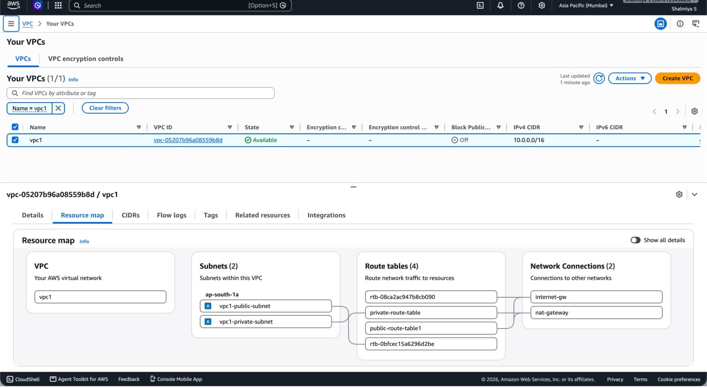
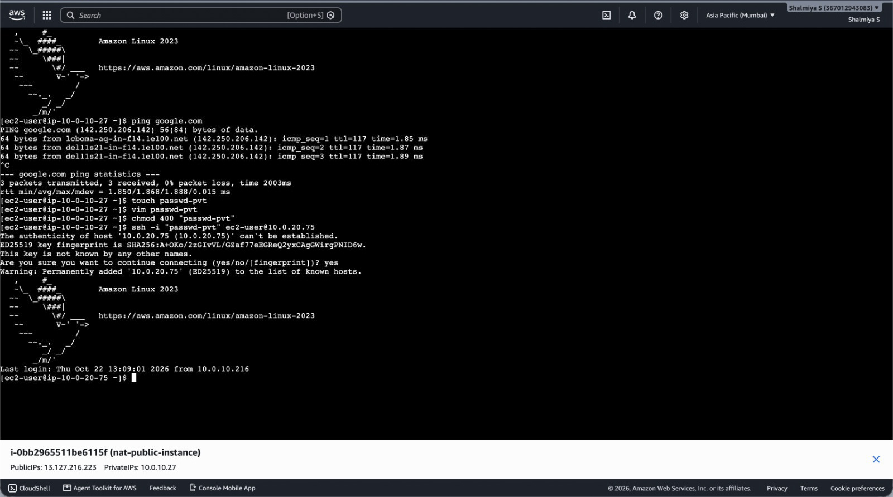
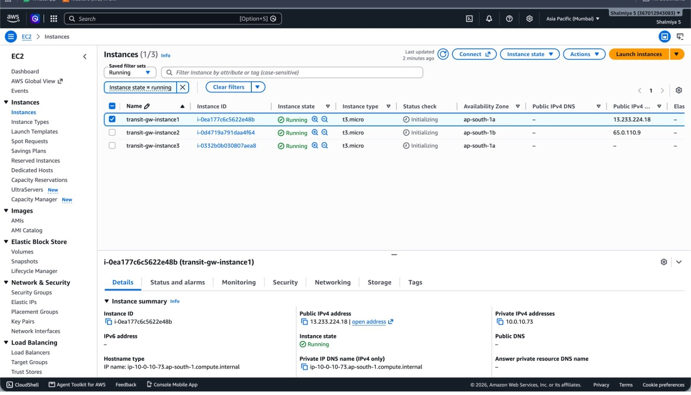
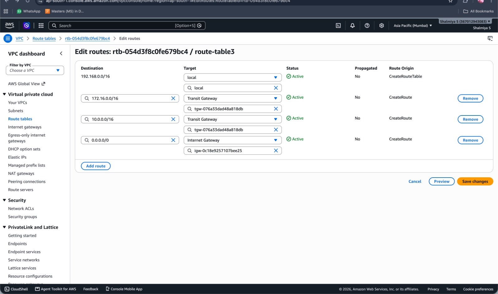

# AWS VPC, NAT Gateway & Transit Gateway Networking Project

## Project Overview

This hands on AWS networking project demonstrates the configuration of a custom Amazon VPC, public and private subnets, an Internet Gateway, a NAT Gateway, and Transit Gateway connectivity testing between network resources.

The project focuses on network segmentation, routing, private subnet internet access, and connectivity verification using Amazon EC2.

## AWS Services Used

- Amazon VPC
- Public and private subnets
- Internet Gateway (IGW)
- NAT Gateway
- Route tables
- Security groups
- AWS Transit Gateway
- Amazon EC2
- Amazon Linux

## 1. VPC Network Configuration

Configured a custom VPC named `vpc1` with the IPv4 CIDR range `10.0.0.0/16`.

The VPC resource map shows:
- A public subnet
- A private subnet
- Multiple route tables
- An Internet Gateway
- A NAT Gateway

### VPC Resource Map



## 2. NAT Gateway Configuration

Configured a NAT Gateway to support outbound internet access for resources in the private subnet, subject to the associated route table configuration.

The private subnet's default IPv4 route should point to the NAT Gateway, while the NAT Gateway must be placed in a public subnet with a route to the Internet Gateway.

This allows private resources to initiate supported outbound connections without being directly reachable through an internet-facing public IP.

## 3. Transit Gateway Connectivity

Configured AWS Transit Gateway to provide centralized connectivity between three VPC networks using a hub-and-spoke architecture.

### VPC Network Configuration

| VPC | IPv4 CIDR Block | Purpose |
|---|---|---|
| VPC A | 10.0.0.0/16 | Primary network |
| VPC B | 172.16.0.0/16 | Secondary network |
| VPC C | 192.168.0.0/16 | Additional network |

### Architecture

```text
          VPC A
       10.0.0.0/16
             |
             |
      AWS Transit Gateway
          /       \
         /         \
      VPC B       VPC C
  172.16.0.0/16  192.168.0.0/16
```

The Transit Gateway acts as a central networking hub, allowing attached VPCs to communicate through configured Transit Gateway route tables and VPC subnet route tables.

### Connectivity Testing

Connectivity testing was performed from an Amazon Linux EC2 instance using the `ping` command.

**Test 1:**
- Destination IP: `192.168.10.216`
- Result: 6 packets received
- Packet loss: 0%

**Test 2:**
- Destination IP: `10.0.10.73`
- Result: 6 packets received
- Packet loss: 0%

Both tests received successful ICMP responses, demonstrating connectivity to the tested IP addresses at the time of testing.

### Transit Gateway Connectivity Test


Successful responses demonstrate IP connectivity to the tested destinations at the time of testing. The Transit Gateway attachment and route table configurations should be checked separately to document the exact network path.

## 4. Networking Concepts Practiced

- VPC CIDR planning
- Public and private subnet design
- Internet Gateway configuration
- NAT Gateway and private subnet routing
- Route table configuration
- Transit Gateway connectivity
- Security group rules
- EC2-based network troubleshooting
- ICMP ping testing

## 5. Project Validation

- Reviewed the VPC resource map in the AWS Management Console.
- Verified the presence of public and private subnets, route tables, Internet Gateway, and NAT Gateway.
- Tested IP connectivity from an Amazon Linux EC2 instance.
- Observed successful ping responses with 0% packet loss for both displayed destinations.

## 6. Cost Management and Cleanup

This is a hands on learning project, not a permanently hosted production environment.

AWS NAT Gateways and Transit Gateway attachments can incur charges while provisioned, even when traffic is low or absent. EC2 instances, public IPv4 addresses, and other resources may also incur charges.

Review AWS Billing and Cost Management, and remove billable resources when the lab is complete. Delete resources in the correct dependency order to avoid deletion errors.

## Disclaimer

This project was built for AWS networking practice and educational purposes. The screenshots represent the configuration and connectivity tests captured during the lab. 

## Screenshots







